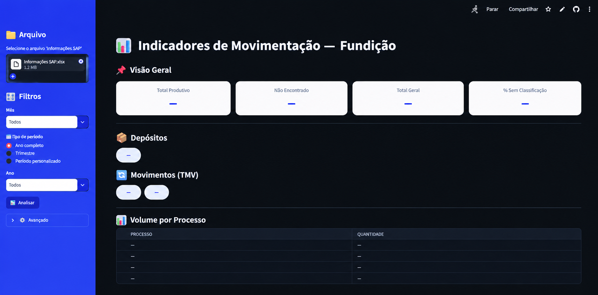

<h1 align="center"> Indicadores de Movimentação — Fundição </h1>

<p align="center">



**[🔗 Acesse o Dashboard aqui](https://wk5pcmezysjxfwukin85id.streamlit.app/)**

</p>

---

## 📋 Introdução ao Projeto

**Dashboard de análise de volumes de consumos e gerações da fábrica**: uma solução que lê uma planilha Excel de controle (`Informações SAP.xlsm`) e apresenta os indicadores em uma interface interativa, desenvolvida em Streamlit.

Através de uma **interface intuitiva**, o usuário seleciona o arquivo, escolhe a aba e o período, e obtém:

- Total produtivo, total não classificado ("Não Encontrado") e % sem classificação
- Depósitos e tipos de movimento (TMV) presentes no período
- Volume por processo
- Base de dados filtrada pelo período
- Análises exclusivas da aba **Sólidos** (Lingote AL e Outros Sólidos SF)

O objetivo principal do projeto foi **aprender a desenvolver dashboards usando Python**, aplicando os conceitos em um caso real de análise de dados industriais.

---

## 🎯 Principais Benefícios

✅ Não exige instalação: roda direto no navegador  
✅ Os dados **não saem do computador** do usuário (processamento local, sem envio a servidor)  
✅ Atualização simples: basta selecionar a versão mais recente da planilha  
✅ Filtros por ano, trimestre ou período personalizado  
✅ Interface gráfica amigável para o usuário final

---

## 🛠️ Tecnologias Utilizadas

- ✅ **Python**: lógica de tratamento e análise
- ✅ **Pandas**: manipulação dos dados do Excel
- ✅ **openpyxl**: leitura de arquivos `.xlsm` / `.xlsx`
- ✅ **Streamlit**: interface do dashboard
- ✅ **stlite**: executa o Streamlit inteiro no navegador (WebAssembly), permitindo hospedar no GitHub Pages

---

## 🚀 Como usar

1. Acesse o link do dashboard.
2. Na barra lateral, em **📁 Arquivo**, selecione o `Informações SAP.xlsm`.
3. Aguarde o carregamento das bases.
4. Escolha a **aba** e o **tipo de período** (ano completo, trimestre ou personalizado).
5. Clique em **▶️ Analisar**.

> ⏳ A primeira abertura pode levar cerca de 1 minuto, pois o navegador baixa o Python e as bibliotecas. Nas próximas vezes fica em cache.

---

## 📑 Estrutura esperada da planilha

**Abas processadas:** AnteLiga, Metal SF, Escoria, Consumo Sucata, Metal Fusao, Solidos, Geracao Sucata Fundicao.

**Colunas obrigatórias em cada aba:** `DATA ORIGINAL`, `QUANTIDADE`, `PROCESSO`  
**Colunas opcionais:** `DEP.`, `TMV`

Abas que não existirem ou não tiverem as colunas obrigatórias são ignoradas, com um aviso na tela.

> A coluna `QUANTIDADE` é convertida automaticamente (sinal invertido e dividida por 1000, ou seja, kg → t).

---

## 📂 Estrutura do repositório

```
├── index.html   # Carrega o stlite e inicia o app no navegador
├── app.py       # Código do dashboard (Streamlit)
├── banner.png   # Imagem do README
└── README.md
```
## ⚠️ Limitações conhecidas

- Arquivos Excel muito grandes podem demorar mais para carregar, pois o processamento ocorre no navegador.
- A planilha precisa ser selecionada a cada nova sessão.
